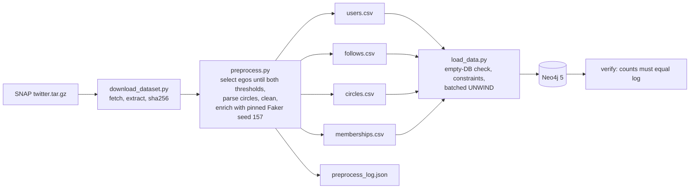
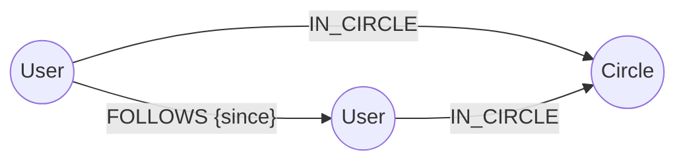
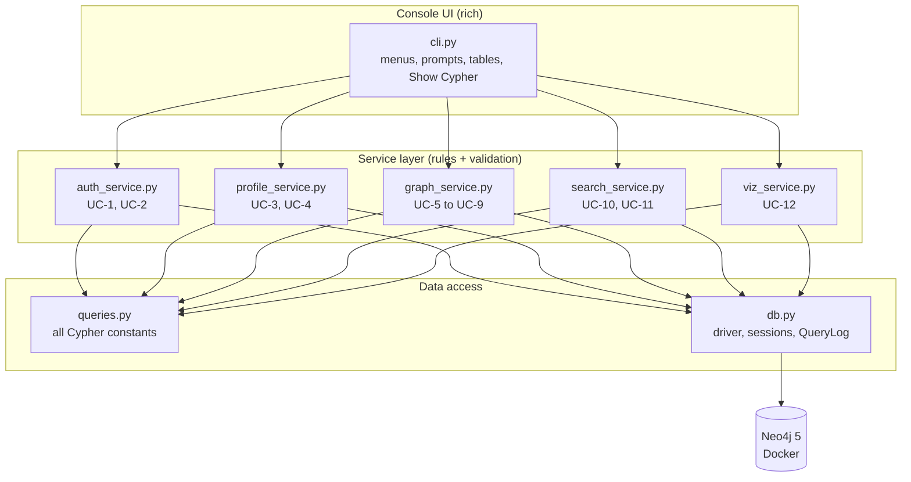
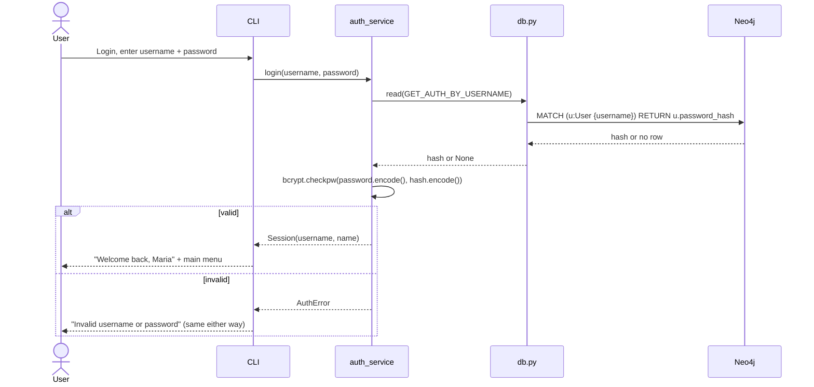
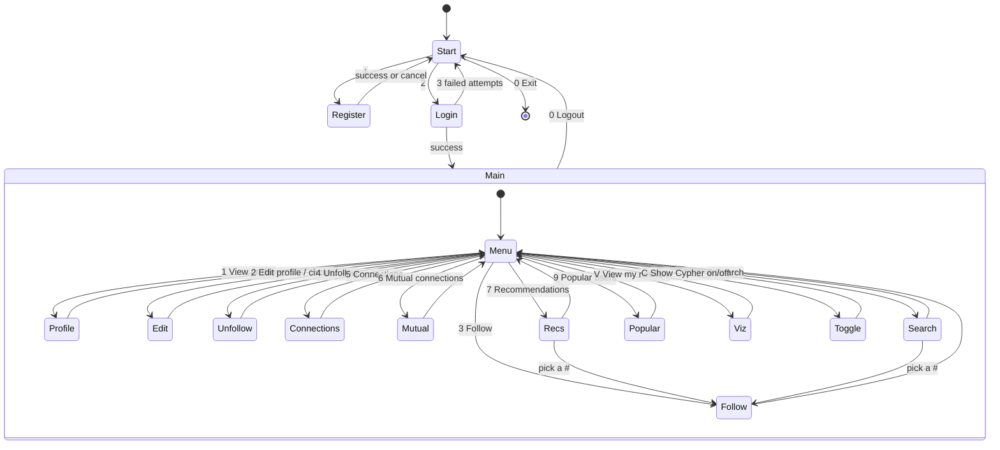

# Cypher Circle: Design Document (v8, implementation-ready)

**Course:** SJSU CS157C NoSQL Database Systems, Team Project
**Stack:** Python 3.13.x console application with a browser-based generated network visualization, Neo4j 5.26.0 (Community), SNAP `ego-Twitter` dataset (subset)
**Status:** Design reviewed, ready for implementation

**Changes from v1:** dataset switched from `email-Eu-core` to `ego-Twitter` (real follow edges). `Department` replaced by `Circle`. Visualization promoted from bonus to required-until-confirmed. Fixed: duplicate-registration check, UC-8 totals, multi-query Show Cypher logging, username generation, timestamp format, `source_id` uniqueness, circle removal, loader idempotency, reproducible report build, 3-person team split.

**Changes from v2:** ego network count corrected to 973. Removed the optional `twitter_combined` step so output is always reproducible. Seeded password hash is now a fixed constant (bcrypt salts are random). `Circle` nodes now come from Twitter's real `.circles` lists, with string IDs. Subset selection continues until **both** user and edge thresholds are met. Demo search term is computed during preprocessing. Neo4j image pinned. Visualization's browser output described explicitly.

**Changes from v3:** added `scripts/seed_constants.py`, `cyphercircle/errors.py`, and `tests/fixtures/twitter_mini/` to the structure. Neo4j exceptions are now translated inside `db.py`, so services never import `neo4j`. Query-log redaction is recursive, and loader queries are never logged. Full determinism rules for RNG and CSV ordering. Stable tie-breakers on every `ORDER BY` and `collect`. Manual download keeps the original archive so the checksum is consistent. Neo4j pinned to an exact patch. Demo users for screenshots computed during preprocessing. Tests cover users with and without circles.

**Changes from v4:** every `collect` is now ordered. The empty-database check covers all nodes, not just users. `busy_user` has an exact formula, fallback, and tie-breaker. Circle names include the owner's unique username, so they can't collide. New `make demo-info` command. Exact dependency pins and the real seeded password hash are recorded; environment verification is an explicit acceptance check.

**Changes from v5:** exact extraction layout, with safe tar extraction. `demo_users` JSON structure defined. Report wording for filtered circle membership and reconstructed ego edges. App startup uses the same all-nodes check as the loader. Dependency verification is an explicit acceptance check for Python 3.13. Visualization HTML is fully self-contained. Build plan starts with a vertical slice.

**Changes from v6:** Python requirement is pinned to the project's local Python 3.13 runtime, which provides the secure `tarfile` extraction filter. Extraction now records a marker containing the archive SHA-256, skips only when the marker matches, and safely re-extracts through a temporary directory when the archive changes or extraction is incomplete. Added extraction-marker acceptance tests.

**Changes from v7:** Replaced the Claude Code wording with Codex/`AGENTS.md` instructions; made synthetic relationship timestamps bounded and reproducible; strengthened archive completeness and allowlist validation; added strict integration-test execution; guaranteed demo users have the required recommendation scenarios; aligned the Neo4j driver and server pins; clarified the assumed grading requirements, provenance, dataset limitations, Community Edition enforcement limits, bcrypt byte handling, report packaging, search behavior, test identifiers, and filename conventions.

---

## 0. Implementation Instructions for Codex

The repository should contain a concise root-level `AGENTS.md` that points to this document and repeats only the durable implementation rules. The repository copy of this document should be named `DESIGN.md`; the uploaded/history filename may differ.

Read this whole document before writing any code. Then:

1. Build the project exactly as laid out in **Section 8 (Project Structure)**.
2. Implement in the order given in **Section 13 (Build Plan)**, starting with the vertical slice in Milestone 0. Each milestone has acceptance criteria. Don't move on until they pass.
3. Every Cypher query lives in `cyphercircle/queries.py` as a named constant. Services import from there. Never inline Cypher in the CLI or services. The report shows each query next to its use case, so keeping them in one file matters.
4. Use parameterized queries only (`$param`). Never build Cypher with f-strings or string concatenation from user input.
5. Don't download anything at runtime other than the dataset in `scripts/download_dataset.py`. If the download fails, print the manual instructions from Section 4.2 and exit non-zero.
6. Use the exact versions in Section 9. Verify them with `make verify-env` on the supported Python versions. Don't upgrade any of them without updating this document, because the synthetic data depends on the exact Faker version.
7. Ask before adding any dependency not listed in Section 9.
8. When something here is ambiguous, pick the simplest option that satisfies the use case, and leave a `# DESIGN NOTE:` comment explaining the choice.

---

## 1. Assignment Summary

### 1.1 Confirmed requirements (from this semester's Section II)

- Team of 3 or 4.
- Front end in Java or Python.
- Back end in Neo4j managing user connections and relationships.
- A public dataset integrated to populate the network.
- Use cases "such as" registration, following connections, friend recommendations, and **network visualization**.

### 1.2 Assumed requirements (from last semester's copy of the same assignment)

These come from a prior-semester copy of this assignment. They're very likely still accurate, but **confirm against this semester's Canvas page before submission**.

Until confirmed, these are planning assumptions only. Do not state the grading split, the 11-use-case count, the exact submission archive contents, or the console-sufficiency rule as confirmed requirements in the final report. The current confirmed requirements are the professor-provided requirements in Section 1.1; the project intentionally implements additional functionality to reduce grading risk.

| Assumption | Source |
|---|---|
| Console interface is sufficient | prior copy |
| Dataset ≥ 1,000 nodes and ≥ 5,000 relationships | prior copy |
| The 11 use cases listed below | prior copy |
| 70-point grading split (schema 5, dataset 5, use cases 55) | prior copy |
| Deliverable `projects.zip` with `report.pdf` + source folder | prior copy |
| One labeled console screenshot + Cypher per use case | prior copy |

### 1.3 Use cases

| ID | Group | Use case | Status |
|----|-------|----------|--------|
| UC-1 | User Management | User registration (name, email, username, password) stored as a node | Required |
| UC-2 | User Management | User login with username and password | Required |
| UC-3 | User Management | View own profile | Required |
| UC-4 | User Management | Edit profile (name, bio, other details) | Required |
| UC-5 | Social Graph | Follow another user (`FOLLOWS` edge) | Required |
| UC-6 | Social Graph | Unfollow a user | Required |
| UC-7 | Social Graph | View connections, **following** and **followers** shown separately | Required |
| UC-8 | Social Graph | Mutual connections (users followed by both parties) | Required |
| UC-9 | Social Graph | Friend recommendations (you follow A, A follows B, so recommend B) | Required |
| UC-10 | Search | Search users by name or username | Required |
| UC-11 | Search | Explore popular users (most followed) | Required |
| UC-12 | Exploration | Network visualization (generated HTML opened in the browser) | **Required until the professor confirms it's optional** (it's named in this semester's Section II). Also confirm a browser-rendered view is acceptable alongside the console app |

### 1.4 Grading (assumed, see 1.2)

| Report section | Points |
|---|---|
| Property graph schema | 5 |
| Dataset info: name, URL, description, processing and loading steps, Cypher used | 5 |
| Use case evidence: labeled console screenshots, each with its Cypher | 55 (11 × 5) |
| Team info (names, emails) | required, ungraded |

The code exists to produce clean, convincing screenshots and a strong report. Design choices below favor that.

---

## 2. Design Goals

These fix weaknesses seen in a reference implementation of this assignment from a prior semester.

| # | Common gap | Cypher Circle's fix |
|---|---|---|
| G1 | Dataset nodes are bare numeric IDs, so name search finds nothing and profiles look empty | Deterministic synthetic profiles (name, username, email, bio, location, join date) from a pinned Faker version and fixed seed |
| G2 | Undirected friendships loaded as one-way `FOLLOWS`, misrepresenting the data | Use `ego-Twitter`, where every edge **is** a directed follow. No reinterpretation needed |
| G3 | One or more queries per edge, so tens of thousands of round trips | Preprocess to CSV, then batched `UNWIND` (1,000 rows per transaction) |
| G4 | No uniqueness constraints or indexes | Constraints on `username`, `email`, `source_id`, `Circle.circle_id`. Text indexes for search |
| G5 | Plain-text passwords | bcrypt. Hash never leaves the auth path |
| G6 | Recommendation score computed and discarded | Score shown ("followed by 4 people you follow") with up to 3 example connectors |
| G7 | Empty recommendations for new users | Fallback: popular in your circles, then popular globally |
| G8 | Flat schema | Adds `Circle` nodes built from the dataset's real Twitter circle lists |
| G9 | Screenshots don't show the queries | Show Cypher toggle prints **every** query run during an action |
| G10 | Weak input handling | Explicit messages for self-follow, duplicate follow, unknown user, taken username/email |

---

## 3. Name and Identity

**Project name:** Cypher Circle
**Tagline:** "Every connection is a query."
**CLI banner:** title rendered with `rich`, plus a one-line stats bar (`<users> users · <follows> follows · <circles> circles`) pulled live from `VERIFY_COUNTS`. Never hardcode these numbers.

---

## 4. Dataset

### 4.1 Choice: SNAP `ego-Twitter`, deterministic subset

| Field | Value |
|---|---|
| Name | ego-Twitter (Social circles: Twitter) |
| Source | Stanford SNAP, https://snap.stanford.edu/data/ego-Twitter.html |
| Format documentation | Stanford SNAP, https://snap.stanford.edu/data/readme-Ego.txt |
| Full size | 81,306 nodes, 1,768,149 directed edges, 973 ego networks |
| Edge meaning | In `<egoId>.edges`, a line `a b` means **a follows b**. The ego node isn't listed in its own file, but is assumed to follow every node that appears in it |
| Citation | J. McAuley and J. Leskovec. *Learning to Discover Social Circles in Ego Networks.* NIPS, 2012 |
| What we use | A deterministic subset of ego networks (target ≥ 3,000 users and ≥ 5,000 edges), plus the egos' real circle lists |

**Why this dataset:**
- Edges are real follows, so `FOLLOWS` needs no justification. This was the main concern with the email dataset in v1.
- It's directed and asymmetric. "Following" and "followers" lists genuinely differ, which is exactly what UC-7 asks us to show.
- It's dense (average clustering coefficient about 0.57), so mutual connections and recommendations return rich results.
- Each ego's `.circles` file holds its real user-defined lists, which become `Circle` nodes. That gives us a second node type taken from the data, not invented.

**Why a subset:** the full graph would make loading slow and screenshots noisy. A few thousand users clears the 1,000 / 5,000 thresholds by a wide margin and keeps every query fast.

**Rejected alternatives (keep for the report's "dataset choice" paragraph):**
- `ego-Facebook`: undirected. Converting to reciprocal follows makes following and followers lists identical, which undermines UC-7. It's also the dataset used by the prior-semester reference project.
- `email-Eu-core`: directed and clean, but "sent an email to" isn't a follow.

### 4.2 Files

Download `https://snap.stanford.edu/data/twitter.tar.gz` to `data/raw/twitter.tar.gz`. The script computes its SHA-256, then extracts it.

**Extraction layout.** The archive has a top-level `twitter/` folder, so extract into `data/raw/` (not `data/raw/twitter/`). The result must be:

```
data/raw/twitter.tar.gz
data/raw/twitter/<egoId>.edges
data/raw/twitter/<egoId>.circles
...
```

Rules:
- The project requires Python **3.13.x**, which provides the `tarfile` extraction-filter argument. Extract with Python's `tarfile` using `filter="data"`, which blocks the dangerous link/path cases handled by that filter. Never shell out to `tar`.
- Before extraction, inspect the archive member list. Allow only the expected top-level `twitter/` directory and files matching `<numeric-ego-id>.(edges|circles|feat|egofeat|featnames)`. Reject symlinks, hard links, device files, unexpected paths, duplicate member names, excessive member sizes, and unexpected file extensions.
- After computing the archive hash, compare it with the exact contents of `data/raw/twitter/.archive_sha256`.
- Skip extraction only when the marker exists, matches the current archive hash, and a validation pass confirms that the extracted file names and regular-file sizes exactly match the archive's expected member manifest. The existence of one or more `.edges` files alone is not sufficient to prove that extraction completed.
- If the marker is missing, does not match, or the extracted directory is incomplete, extract into a temporary sibling directory first. Validate the temporary layout, then replace the old extracted directory and write the new marker. Never leave a partially extracted directory as a valid dataset.
- After extracting, assert that the extracted manifest matches the archive manifest, that all expected extension groups are present, that `data/raw/twitter/*.edges` matches at least one file, and that `data/raw/twitter/twitter/` does **not** exist. If the layout is wrong, fail with a message showing what was found.
- The marker contains only the lowercase hexadecimal SHA-256 digest followed by a newline. It is generated after successful extraction and is gitignored with the raw dataset.

The archive contains, per ego:

| File | Use |
|---|---|
| `<egoId>.edges` | Directed follow edges `a b` among the ego's followees. **Used** |
| `<egoId>.circles` | The ego's user-defined circles (lists). One circle per line: a circle label, then member node IDs, whitespace separated. **Used** for `Circle` nodes |
| `<egoId>.feat`, `.egofeat`, `.featnames` | Profile features. **Not used.** We don't import real hashtags or mentions |

We do **not** use `twitter_combined.txt.gz`. The per-ego files provide plenty of edges, and depending on a second optional file would make output differ between teammates.

If the download script can't reach SNAP, print the URL and tell the user to save the **original, unextracted** archive to `data/raw/twitter.tar.gz`, then rerun the script. When that file already exists, the script skips the download and goes straight to checksum + extract. Never ask users to extract it themselves, so the checksum is always computed the same way.

The script records the archive's SHA-256 in `preprocess_log.json` (`archive_sha256`) so teammates can confirm they started from the same file. Once the first teammate runs it, paste the hash into the README so others can compare.

**Note on IDs:** node IDs are numeric identifiers from the dataset. We store them only as `source_id` for traceability. We never try to map them to real accounts, and every displayed field is synthetic.

**Dataset limitation and provenance:** this is not a complete Twitter graph. It is a deterministic union of selected ego networks, with reconstructed edges for the selected egos and filtering to the selected user subset. Missing edges must not be interpreted as proof that two real users were not connected. The report must preserve the SNAP URL, paper citation, archive SHA-256, processing rules, and the fact that SNAP describes the data as crawled from public sources. Do not claim an unrestricted open-source license unless the source explicitly provides one.

### 4.3 Subset selection and cleaning (`scripts/preprocess.py`)

Options: `--target-users 3000` (default), `--min-edges 5000` (default). Every step logs its count to `data/processed/preprocess_log.json`.

1. **List ego IDs** from the `*.edges` filenames, sorted numerically ascending.
2. **Select egos in order.** For each ego, add: the ego, every node in its `.edges` file, the file's edges, and an `ego → node` edge for every node in the file. These ego edges aren't lines in the file. They're reconstructed from SNAP's documented format, which says the ego follows every node in its file. After each ego, run the cleaning from step 4 on the running edge set and check the totals. **Continue until both `users >= target-users` and `edges >= min-edges`.** If every ego is used and either threshold still isn't met, fail loudly.
3. **Parse circles** for the selected egos from `<egoId>.circles`:
   - `circle_id` = `f"{ego_source_id}:{line_index}"` (string, 0-based line index).
   - Preserve the first token as `source_label` for provenance, but do not use it as an identity because labels can repeat across egos and are not guaranteed to be unique.
   - Keep only members that are selected users. Drop circles left with fewer than 3 members, and log how many were dropped.
   - An ego with no `.circles` file, or an empty one, just contributes no circles.
   - Users can belong to several circles. Some belong to none, and that's fine.
4. **Clean edges:** drop self-loops, drop duplicates, drop edges whose endpoints aren't selected users.
5. **Assign local IDs:** sort selected source IDs ascending and give each a 0-based `uid`, used for username suffixes.
6. **Compute the demo search term** (see 4.4).
7. **Assert** final users ≥ 1,000 and edges ≥ 5,000 (the assignment minimum, independent of the defaults).

`preprocess_log.json` fields: `archive_sha256`, `egos_total`, `egos_selected`, `users`, `edges_from_ego_files`, `ego_edges_added`, `self_loops_dropped`, `duplicates_dropped`, `dangling_dropped`, `edges_final`, `circles_raw`, `circles_dropped_small`, `circles`, `memberships`, `users_without_circle`, `demo_search_term`, `demo_search_matches`, `demo_users`, `faker_version`, `seed`. The report quotes these numbers directly. The extraction marker is not duplicated in this log; `archive_sha256` is the authoritative value.

All `demo_users` values are **usernames** (strings), or `null` where noted:

```json
{
  "demo_search_term": "jen",
  "demo_search_matches": 41,
  "demo_users": {
    "busy_user": "maria.k_0412",
    "busy_user_rule": "0.20",
    "busy_user_network_recommendations": 35,
    "mutual_partner": "james.t_0087",
    "no_circle_user": "anna.b_0003"
  }
}
```

The values above are only examples of the shape. Real values come from the run.

### 4.4 Synthetic enrichment (fixes G1)

The dataset does not provide usable human-readable display fields for this application, so we generate them. **Every generated field below is synthetic, and the report must say so.**

- `Faker` pinned with `==`, seed `157`, locale `en_US`. Generate in `uid` order so output is reproducible.
- `name`: `fake.first_name() + " " + fake.last_name()`. Don't use `fake.name()`, which can add prefixes and suffixes like "Dr." or "Jr.".
- `username` rules:
  1. ASCII-normalize first and last name: `unicodedata.normalize("NFKD", s).encode("ascii", "ignore").decode()`.
  2. Lowercase, then strip everything outside `[a-z]`.
  3. First name truncated to 12 chars. If empty after cleaning, use `user`.
  4. Last initial: first char of the cleaned last name, or `x` if empty.
  5. Format: `f"{first}.{initial}_{uid:04d}"`, e.g. `maria.k_0412`. For the default target below 10,000 users this is at most 19 characters; if a larger target is requested, the regex maximum of 30 characters is authoritative.
  6. Assert each matches `^[a-z0-9._]{3,30}$` and all are unique. Fail loudly otherwise.
- `email`: `f"{username}@example.com"`. `example.com` is reserved for documentation by RFC 2606, so it can't collide with real addresses.
- `bio`: `fake.sentence(nb_words=10)`, truncated to 160 chars.
- `location`: `fake.city()`.
- `joined_at`: random timestamp between 2022-01-01 and 2025-12-31, serialized as full UTC ISO-8601: `2024-04-12T09:15:00Z`.
- `FOLLOWS.since`: random timestamp in the fixed interval from `max(joined_at(src), joined_at(dst))` through `2025-12-31T23:59:59Z`, same format. This makes every seeded follow occur after both users joined and keeps preprocessing reproducible.
- **Circle names:** the dataset's circle labels are generic, so names are synthetic: `f"@{owner_username}'s list {n}"` with `n` = line index + 1, e.g. "@maria.k_0412's list 3". Usernames are unique and `n` is unique per owner, so circle names can never collide. Membership is real data. Only the names are made up. `preprocess.py` asserts all circle names are unique.
- **Seeded-user password:** all seeded users share the demo password `cypher123`. bcrypt uses a random salt, so hashing during every run would change `users.csv` each time. Instead, generate the hash **once** at implementation time and commit it as a constant in `scripts/seed_constants.py`:
  ```python
  SEEDED_PASSWORD = "cypher123"
  SEEDED_PASSWORD_HASH = "$2b$12$sOZTquqgbRZDfjJ34/ro3eK04iudY1AzI2yjtLTajCiZ0WED5.DR2"  # generated once, never regenerated
  ```
  `test_preprocess.py` asserts `bcrypt.checkpw(SEEDED_PASSWORD.encode("utf-8"), SEEDED_PASSWORD_HASH.encode("ascii"))`. The same byte conversion is required in the login path. This is a public, demo-only credential and must never be presented as production security.
- **Demo users for screenshots:** computed from the cleaned edges and saved as `demo_users` in the log:
  - `busy_user`: used for UC-7 to UC-9 and UC-12, so the asymmetry is visible. It must also have at least one valid network-tier recommendation under the exact `RECOMMEND_BY_NETWORK` predicate; otherwise preprocessing fails or selects the next deterministic candidate. Computed from the cleaned edges:
    1. For each user, `following` = out-degree, `followers` = in-degree.
    2. Candidates: `following >= 10`, `followers >= 10`, and `asymmetry = abs(following - followers) / max(following, followers) >= 0.20`.
    3. Pick the candidate with the most followers. Ties: higher asymmetry, then username ascending.
    4. Fallback if there are no candidates: retry step 2 with `>= 0.10`, still requiring at least one network recommendation. If still none, take the user with the most followers who has a network recommendation (ties by username). If no user satisfies this, fail preprocessing with a clear message rather than producing a broken demo. Log which rule was used as `demo_users.busy_user_rule` (`"0.20"`, `"0.10"`, or `"top_followers"`).
    5. Log `demo_users.busy_user_network_recommendations`, the count produced by the same exclusion and two-hop logic used by UC-9.
  - `mutual_partner`: among the top 20 users by followers (ties by username), excluding `busy_user`, the one sharing the most followees with `busy_user`. Ties by username ascending.
  - `no_circle_user`: the first user by `uid` with zero circles and `following >= 5`. Used to demo and test the no-circle fallback. If none exists, set it to `null` and log it.
  - **Demo search term:** after names and usernames are generated, find the 3-letter lowercase prefix that produces the largest full result set under the dataset-wide UC-10 predicate (`name_lc CONTAINS q OR username CONTAINS q`). Consider prefixes of generated first names, require at least one match, and break ties alphabetically. Save it as `demo_search_term` and log the full dataset-wide predicate match count, not merely the number of name-prefix matches. The live query may subtract the logged-in user from that count because self-exclusion is session-specific.

### 4.4.1 Determinism rules

Running `make data` twice on the same archive must produce byte-identical files. To guarantee it:

- Create one RNG: `rng = random.Random(157)`. Seed Faker with `Faker.seed(157)` and also seed the instance (`fake.seed_instance(157)`). Never call the global `random` module or `datetime.now()` during preprocessing.
- All timestamps (`joined_at`, `since`) are drawn from `rng`, never from Faker's date helpers, so one RNG controls them. Generate them in a fixed order: users by `uid`, then edges in their sorted order. Use these explicit fixed bounds: `joined_at` is in `[2022-01-01T00:00:00Z, 2025-12-31T23:59:59Z]`; `since` is in `[max(joined_at(src), joined_at(dst)), 2025-12-31T23:59:59Z]`. This ensures every seeded follow occurs after both users joined and avoids unbounded or future timestamps.
- Iterate over sets only after sorting. Never rely on set or dict ordering of source IDs.
- Sort rows before writing:
  - `users.csv` by `uid`
  - `follows.csv` by (`src`, `dst`)
  - `circles.csv` by `circle_id` (string sort), with a fixed column order including `source_label`
  - `memberships.csv` by (`circle_id`, `source_id`)
- Write CSVs with `csv.writer(..., lineterminator="\n")`, UTF-8, no BOM, a fixed column order, and a header row.
- Write `preprocess_log.json` with `json.dump(..., sort_keys=True, indent=2)` and a trailing newline. Don't include run times or timestamps in it.
- `test_preprocess.py` runs preprocessing twice on the fixture and compares file hashes.

### 4.5 Data pipeline



---

## 5. Property Graph Schema

### 5.1 Diagram



### 5.2 Nodes

**`:User`**

| Property | Type | Required | Notes |
|---|---|---|---|
| `username` | String | yes | Unique. Lowercase. `^[a-z0-9._]{3,30}$` |
| `email` | String | yes | Unique. Lowercase |
| `name` | String | yes | Display name |
| `name_lc` | String | yes | Lowercased `name`, for case-insensitive search |
| `password_hash` | String | yes | bcrypt. Never printed or returned outside auth |
| `bio` | String | no | Max 160 chars |
| `location` | String | no | |
| `joined_at` | DateTime | yes | |
| `updated_at` | DateTime | no | Set on profile edit |
| `source_id` | Integer | no | Unique. Only on dataset users |
| `source` | String | yes | `"snap"` or `"app"` |

**`:Circle`**

| Property | Type | Notes |
|---|---|---|
| `circle_id` | String | Unique. `"<ego_source_id>:<line_index>"`, e.g. `"12831:2"` |
| `name` | String | Synthetic, e.g. "@maria.k_0412's list 3" |
| `source_label` | String | Original first token from the SNAP `.circles` line; retained for provenance and not used as identity |
| `owner_source_id` | Integer | The ego who created the list |

### 5.3 Relationships

| Type | From → To | Properties | Meaning |
|---|---|---|---|
| `FOLLOWS` | User → User | `since: DateTime` | Directed. Never a self-loop |
| `IN_CIRCLE` | User → Circle | none | Membership from the dataset's real circle lists. A user can have zero or more. App users can join or leave circles |

### 5.4 Constraints and indexes (fixes G4)

```cypher
CREATE CONSTRAINT user_username_unique IF NOT EXISTS
FOR (u:User) REQUIRE u.username IS UNIQUE;

CREATE CONSTRAINT user_email_unique IF NOT EXISTS
FOR (u:User) REQUIRE u.email IS UNIQUE;

CREATE CONSTRAINT user_source_id_unique IF NOT EXISTS
FOR (u:User) REQUIRE u.source_id IS UNIQUE;

CREATE CONSTRAINT circle_id_unique IF NOT EXISTS
FOR (c:Circle) REQUIRE c.circle_id IS UNIQUE;

CREATE TEXT INDEX user_name_lc_text IF NOT EXISTS
FOR (u:User) ON (u.name_lc);

CREATE TEXT INDEX user_username_text IF NOT EXISTS
FOR (u:User) ON (u.username);
```

Uniqueness constraints create backing indexes, so lookups by `username`, `email`, `source_id`, and `circle_id` are index-backed. Users without `source_id` (app-registered) don't violate the constraint, since missing properties aren't checked.

Neo4j Community does not provide property-existence constraints. Therefore, the `Required` column describes the application/data-pipeline contract, while uniqueness is database-enforced. The loader and services must validate required values before writes, and integration tests must verify that malformed writes are rejected by the application layer.

---

## 6. Architecture

### 6.1 Layers



**Rules:**
- The CLI only talks to services. It never touches the driver.
- Services hold validation and business rules, and return dataclasses (6.3), not Neo4j records.
- `db.py` is the only module that imports `neo4j`. It translates driver exceptions into app exceptions from `cyphercircle/errors.py`, so services never see Neo4j types:
  ```python
  class CypherCircleError(Exception): ...
  class DataIntegrityError(CypherCircleError): ...      # from neo4j.exceptions.ConstraintError; carries the constraint name
  class DatabaseUnavailableError(CypherCircleError): ... # from ServiceUnavailable / AuthError at connect time
  class QueryError(CypherCircleError): ...              # any other Neo4jError
  ```
- It exposes `read(name, query, **params)` and `write(name, query, **params)`, each returning `(records, summary)`. `name` is the constant's name, e.g. `"RECOMMEND_BY_NETWORK"`.
- Config comes from `.env` (`NEO4J_URI`, `NEO4J_USER`, `NEO4J_PASSWORD`). Never hardcode credentials.

### 6.2 Query log for Show Cypher (fixes the multi-query issue)

`db.py` owns a `QueryLog`:

```python
@dataclass
class LoggedQuery:
    name: str
    query: str
    params: dict      # already redacted
    rows: int

class QueryLog:
    def begin_action(self, label: str) -> None: ...   # clears the list, sets e.g. "UC-9"
    def record(self, entry: LoggedQuery) -> None: ...
    def entries(self) -> list[LoggedQuery]: ...
```

- The CLI calls `begin_action("UC-x")` at the start of each menu action.
- Every `read`/`write` appends to the log, in order.
- Redaction is **recursive**: walk params through nested dicts and lists, and replace the value of any key whose lowercase name contains `password` with `"***"`. This covers `password_hash` inside `{"rows": [...]}`.
- Loader queries (`LOAD_*`) are **never** logged. `write()` takes `log=False` and the loader always passes it. Batches of 1,000 rows would flood the log anyway.
- Large list params (more than 20 items) are shown truncated, e.g. `[... 143 items]`.
- `test_validation.py` includes a redaction test with a nested `password_hash`.
- When Show Cypher is on, after the action the CLI prints **every** logged query as numbered panels: `Cypher 1/3 · RECOMMEND_BY_NETWORK · 7 rows`.

### 6.3 Login flow



When the user doesn't exist, still run `bcrypt.checkpw(password.encode(), DUMMY_PASSWORD_HASH.encode())` against a valid dummy hash with the same cost factor so timing doesn't reveal which usernames exist. The dummy hash must never be returned, logged, or stored as a user password.

### 6.4 Return types (`cyphercircle/models.py`)

```python
@dataclass(frozen=True)
class UserSummary:
    username: str
    name: str
    location: str | None
    followers: int

@dataclass(frozen=True)
class Profile:
    username: str
    name: str
    email: str
    bio: str | None
    location: str | None
    circles: list[str]       # up to 5 names
    circle_count: int
    joined_at: datetime
    following_count: int
    followers_count: int

@dataclass(frozen=True)
class Recommendation:
    user: UserSummary
    score: int
    via: list[str]           # up to 3 usernames
    reason: str              # "network" | "circle" | "popular"
    circle: str | None       # set when reason == "circle"

@dataclass(frozen=True)
class Session:
    username: str
    name: str
```

---

## 7. Use Case Specifications

All constants go in `cyphercircle/queries.py`.

### UC-1: User Registration

**Flow:** prompt name, email, username, password (hidden, entered twice), optional bio. Then optionally join up to 3 circles from a numbered list of the 10 largest circles.

**Validation:**
- All four required fields present.
- Username lowercased, matches `^[a-z0-9._]{3,30}$`.
- Email lowercased, matches `^[^@\s]+@[^@\s]+\.[^@\s]+$`.
- Password at least 8 chars, both entries match.
- Username and email free (`CHECK_REGISTRATION_CONFLICTS`). Constraints are the real safety net, so `auth_service` also catches `DataIntegrityError` (raised by `db.py`) and maps it to the same messages using the constraint name.

```cypher
// CHECK_REGISTRATION_CONFLICTS  (always exactly one row)
OPTIONAL MATCH (a:User {username: $username})
OPTIONAL MATCH (b:User {email: $email})
RETURN a IS NOT NULL AS username_taken,
       b IS NOT NULL AS email_taken
```

Report both problems at once if both are taken.

```cypher
// CREATE_USER
CREATE (u:User {
  username: $username,
  email: $email,
  name: $name,
  name_lc: toLower($name),
  password_hash: $password_hash,
  bio: $bio,
  joined_at: datetime(),
  source: 'app'
})
RETURN u.username AS username, u.name AS name
```

```cypher
// GET_TOP_CIRCLES
MATCH (c:Circle)
RETURN c.circle_id AS circle_id, c.name AS name,
       COUNT { (:User)-[:IN_CIRCLE]->(c) } AS members
ORDER BY members DESC, name ASC, circle_id ASC
LIMIT $limit
```

Circle joins use `JOIN_CIRCLE` (UC-4).

**Screenshot:** filled-in prompts, then "Account created for @newuser".

### UC-2: User Login

```cypher
// GET_AUTH_BY_USERNAME
MATCH (u:User {username: $username})
RETURN u.password_hash AS password_hash, u.name AS name
```

Same error for unknown user and wrong password. 3 attempts, then back to the start menu.

**Screenshot:** login prompt, then the welcome message and main menu.

### UC-3: View Profile

```cypher
// GET_PROFILE
MATCH (u:User {username: $username})
OPTIONAL MATCH (u)-[:IN_CIRCLE]->(c:Circle)
WITH u, c ORDER BY c.name ASC, c.circle_id ASC
WITH u, collect(c.name) AS circle_names
RETURN u.username AS username, u.name AS name, u.email AS email,
       u.bio AS bio, u.location AS location, u.joined_at AS joined_at,
       circle_names[..5] AS circles, size(circle_names) AS circle_count,
       COUNT { (u)-[:FOLLOWS]->(:User) } AS following_count,
       COUNT { (:User)-[:FOLLOWS]->(u) } AS followers_count
```

**Display:** `rich` panel. Circles line shows up to 5 names, plus "+N more" if `circle_count > 5`. If the user has no circles, show "No circles yet" with a hint to join one from Edit Profile. Never show `password_hash`.

**Screenshot:** the profile card.

### UC-4: Edit Profile

Sub-menu: **1** Edit details · **2** Join a circle · **3** Leave a circle · **0** Back.

**Edit details:** name, bio, location. Enter keeps the current value. Name can't become empty. Bio max 160 chars.

```cypher
// UPDATE_PROFILE
MATCH (u:User {username: $username})
SET u.name = coalesce($name, u.name),
    u.name_lc = toLower(coalesce($name, u.name)),
    u.bio = coalesce($bio, u.bio),
    u.location = coalesce($location, u.location),
    u.updated_at = datetime()
RETURN u.username AS username
```

To clear an optional field, the user types `-`. The service then runs the matching constant. Two fixed queries keep it simple and avoid ever putting a field name into the query string.

```cypher
// CLEAR_BIO
MATCH (u:User {username: $username})
SET u.bio = null, u.updated_at = datetime()
```

```cypher
// CLEAR_LOCATION
MATCH (u:User {username: $username})
SET u.location = null, u.updated_at = datetime()
```

**Join / leave circle** (explicitly supports removal):

```cypher
// JOIN_CIRCLE
MATCH (u:User {username: $username}), (c:Circle {circle_id: $circle_id})
MERGE (u)-[:IN_CIRCLE]->(c)
```

```cypher
// LEAVE_CIRCLE
MATCH (u:User {username: $username})-[r:IN_CIRCLE]->(c:Circle {circle_id: $circle_id})
DELETE r
```

```cypher
// GET_MY_CIRCLES
MATCH (u:User {username: $username})-[:IN_CIRCLE]->(c:Circle)
RETURN c.circle_id AS circle_id, c.name AS name
ORDER BY name ASC, circle_id ASC
```

Use `summary.counters` to tell "joined" from "already a member" and "left" from "not a member."

**Screenshot:** edit prompts, then the updated profile card.

### UC-5: Follow a User

**Validation:** target exists, isn't yourself, not already followed. Each case gets its own message.

```cypher
// FOLLOW_USER
MATCH (me:User {username: $me}), (target:User {username: $target})
WHERE me <> target
MERGE (me)-[r:FOLLOWS]->(target)
ON CREATE SET r.since = datetime()
RETURN r.since AS since
```

`summary.counters.relationships_created == 1` means "now following." 0 with a row means "already following." No row: run `USER_EXISTS` to tell "not found" from "can't follow yourself."

```cypher
// USER_EXISTS
MATCH (u:User {username: $username}) RETURN count(u) > 0 AS exists
```

**Screenshot:** "You are now following @maria.k_0412" plus the new following count.

### UC-6: Unfollow a User

```cypher
// UNFOLLOW_USER
MATCH (me:User {username: $me})-[r:FOLLOWS]->(target:User {username: $target})
DELETE r
```

`relationships_deleted == 0` means "You weren't following @x."

**Screenshot:** "You unfollowed @x" plus the new following count.

### UC-7: View Connections

Two separate tables, **Following** and **Followers**, with totals in the headers. 15 rows per page, `n` / `p` / `b` to navigate. Newest first by `since`.

```cypher
// COUNT_CONNECTIONS
MATCH (me:User {username: $username})
RETURN COUNT { (me)-[:FOLLOWS]->(:User) } AS following,
       COUNT { (:User)-[:FOLLOWS]->(me) } AS followers
```

```cypher
// GET_FOLLOWING
MATCH (me:User {username: $username})-[r:FOLLOWS]->(u:User)
RETURN u.username AS username, u.name AS name, u.location AS location,
       r.since AS since,
       EXISTS { (u)-[:FOLLOWS]->(me) } AS follows_back
ORDER BY since DESC, username ASC
SKIP $skip LIMIT $limit
```

```cypher
// GET_FOLLOWERS
MATCH (u:User)-[r:FOLLOWS]->(me:User {username: $username})
RETURN u.username AS username, u.name AS name, u.location AS location,
       r.since AS since,
       EXISTS { (me)-[:FOLLOWS]->(u) } AS i_follow_back
ORDER BY since DESC, username ASC
SKIP $skip LIMIT $limit
```

Mark mutual follows with ↔.

**Screenshot:** both tables with "Following (N)" and "Followers (M)". N and M may differ. The demo uses `busy_user` from `preprocess_log.json`, which is picked to show an asymmetric case.

### UC-8: Mutual Connections

Prompt for another username. Validate it exists and isn't you.

```cypher
// COUNT_MUTUAL_FOLLOWING
MATCH (me:User {username: $me})-[:FOLLOWS]->(m:User)<-[:FOLLOWS]-(other:User {username: $other})
RETURN count(DISTINCT m) AS total
```

```cypher
// GET_MUTUAL_FOLLOWING
MATCH (me:User {username: $me})-[:FOLLOWS]->(m:User)<-[:FOLLOWS]-(other:User {username: $other})
RETURN m.username AS username, m.name AS name, m.location AS location
ORDER BY m.name ASC, m.username ASC
SKIP $skip LIMIT $limit
```

```cypher
// GET_RELATIONSHIP_STATUS
MATCH (me:User {username: $me}), (other:User {username: $other})
RETURN EXISTS { (me)-[:FOLLOWS]->(other) } AS i_follow,
       EXISTS { (other)-[:FOLLOWS]->(me) } AS they_follow
```

**Display:** "You and @x both follow **{total}** people (showing 1–15)." Status line: "You follow each other" / "You follow them" / "They follow you" / "No direct connection." Paginate like UC-7.

**Screenshot:** the header with the true total, the table, and the status line.

### UC-9: Friend Recommendations (fixes G6, G7)

Three tiers, filled in order until `$limit` (default 10) is reached. Every query that runs is logged, so Show Cypher displays all tiers that executed.

The service calculates `remaining = limit - len(results)` after each tier. It passes `remaining` to the next tier and adds every returned username to the exclusion set before running the next tier. It never runs a later tier with the original limit or allows a duplicate across tiers. If a tier returns no rows, it skips directly to the next tier.

```cypher
// RECOMMEND_BY_NETWORK
MATCH (me:User {username: $username})-[:FOLLOWS]->(mid:User)-[:FOLLOWS]->(rec:User)
WHERE rec <> me AND NOT (me)-[:FOLLOWS]->(rec)
WITH rec, mid ORDER BY mid.username ASC
WITH rec, count(DISTINCT mid) AS score, collect(DISTINCT mid.username)[..3] AS via
RETURN rec.username AS username, rec.name AS name, rec.location AS location,
       COUNT { (:User)-[:FOLLOWS]->(rec) } AS followers, score, via
ORDER BY score DESC, followers DESC, username ASC
LIMIT $limit
```

```cypher
// RECOMMEND_BY_CIRCLE
MATCH (me:User {username: $username})-[:IN_CIRCLE]->(c:Circle)<-[:IN_CIRCLE]-(rec:User)
WHERE rec <> me AND NOT (me)-[:FOLLOWS]->(rec) AND NOT rec.username IN $exclude
WITH rec, min(c.name) AS circle
WITH rec, circle, COUNT { (:User)-[:FOLLOWS]->(rec) } AS followers
RETURN rec.username AS username, rec.name AS name, rec.location AS location,
       followers, circle
ORDER BY followers DESC, username ASC
LIMIT $limit
```

Tier 3 reuses `GET_POPULAR_USERS` with an `$exclude` list (self + already followed + already listed). Fetch already-followed usernames once with `GET_FOLLOWING_USERNAMES`:

```cypher
// GET_FOLLOWING_USERNAMES
MATCH (:User {username: $username})-[:FOLLOWS]->(u:User)
WITH u ORDER BY u.username ASC
RETURN collect(u.username) AS usernames
```

**Display:** columns `#`, `User`, `Why`. Examples: "Followed by 4 people you follow (anna.b_0021, li.w_0310, +2)", "Popular in @maria.k_0412's list 3", "Popular on Cypher Circle." Then "Follow one? Enter # or press Enter to skip" (calls UC-5).

**Screenshot:** a seeded user's 10 network recommendations with scores. Extra screenshot: a brand-new user showing circle and popular fallbacks.

### UC-10: Search Users

Case-insensitive substring match on name and username. Minimum 2 chars. Lowercase input in Python.

```cypher
// SEARCH_USERS
MATCH (u:User)
WHERE u.username <> $me
  AND (u.name_lc CONTAINS $q OR u.username CONTAINS $q)
WITH u,
     COUNT { (:User)-[:FOLLOWS]->(u) } AS followers,
     CASE WHEN u.username STARTS WITH $q OR u.name_lc STARTS WITH $q THEN 0 ELSE 1 END AS rank
RETURN u.username AS username, u.name AS name, u.location AS location, followers,
       EXISTS { (:User {username: $me})-[:FOLLOWS]->(u) } AS i_follow
ORDER BY rank, followers DESC, username ASC
LIMIT $limit
```

The service strips surrounding whitespace, lowercases the query, enforces the two-character minimum, and excludes the current user from results so the table cannot offer an invalid self-follow action.

**Display:** table with a "Following" ✓ column, then "Enter # to follow/unfollow, or Enter to go back."

`SEARCH_USERS` receives both `$q` and `$me`; `$me` is the logged-in username used for self-exclusion.

**Screenshot:** searching the `demo_search_term` from `preprocess_log.json` returns a ranked table. The term is computed so it always has matches.

### UC-11: Explore Popular Users

```cypher
// GET_POPULAR_USERS
MATCH (u:User)
WHERE NOT u.username IN $exclude
WITH u, COUNT { (:User)-[:FOLLOWS]->(u) } AS followers
RETURN u.username AS username, u.name AS name, u.location AS location, followers
ORDER BY followers DESC, username ASC
LIMIT $limit
```

Pass `$exclude = []` for the plain leaderboard.

**Display:** top 10 with rank, name, follower count, and a bar of `█` characters scaled to the top value.

**Screenshot:** the leaderboard.

### Ordering rule

Every list a query returns is ordered explicitly. Every `ORDER BY` ends with a unique key (`username` or `circle_id`), and every `collect` is preceded by a `WITH ... ORDER BY`, so repeated calls return identical results and screenshots are reproducible. Services don't re-sort query results. `test_integration.py` runs each list query twice and compares results.

### UC-12: Network Visualization

"View my network" writes an HTML file of the user's ego network and opens it in the browser. Treated as required (see 1.3).

```cypher
// GET_EGO_NETWORK
MATCH (me:User {username: $username})
CALL {
  WITH me
  MATCH (me)-[:FOLLOWS]->(o:User)
  WITH o ORDER BY o.username ASC
  RETURN collect(o)[..$cap] AS outs
}
CALL {
  WITH me
  MATCH (i:User)-[:FOLLOWS]->(me)
  WITH i ORDER BY i.username ASC
  RETURN collect(i)[..$cap] AS ins
}
RETURN me.username AS center, me.name AS center_name,
       [x IN outs | {username: x.username, name: x.name}] AS following,
       [x IN ins  | {username: x.username, name: x.name}] AS followers
```

```cypher
// GET_EDGES_AMONG
MATCH (a:User)-[:FOLLOWS]->(b:User)
WHERE a.username IN $usernames AND b.username IN $usernames
RETURN a.username AS src, b.username AS dst
ORDER BY src ASC, dst ASC
LIMIT $edge_cap
```

**Rendering (pyvis):**
- Center node large.
- Colors: following only, follower only, mutual (both). Legend in the page title.
- Arrows show direction. Include edges among neighbors from `GET_EDGES_AMONG` (cap 500) so it looks like a real network, not a star.
- `$cap` = 50 each way.
- Create the network with `Network(directed=True, cdn_resources="in_line")` so the vis-network library is embedded in the HTML.
- **Strip the Bootstrap links.** Tested with pyvis 0.3.2: even in `in_line` mode, the generated page still links Bootstrap's CSS and JS from `cdn.jsdelivr.net`. Bootstrap only styles the page wrapper, and the graph doesn't need it. After `write_html`, remove those `<link>` and `<script>` tags and add a few lines of inline CSS for the container (full width, 750px height, border). Then assert the file has no `http://` or `https://` `src` or `href` attributes left. Result: the page works with no internet connection.
- Save to `output/network_<username>.html`, then open with `webbrowser.open`.
- No connections: print "No network yet. Follow someone first." and skip.
- If `pyvis` import fails, print an install hint. Never crash.

**Screenshot:** the console confirmation with the file path, plus a browser screenshot of the graph.

### Show Cypher toggle (fixes G9)

Main menu `C` toggles it (default off, or `--show-cypher` flag). See 6.2 for the logging. This lets one screenshot carry both the result and every query behind it.

---

## 8. Project Structure

```
cypher-circle/
├── README.md
├── AGENTS.md                    # concise Codex instructions; points to DESIGN.md
├── DESIGN.md                    # this document; source of truth
├── docker-compose.yml
├── .env.example
├── .gitignore
├── requirements.txt             # all pinned with ==
├── pyproject.toml               # pytest config
├── Makefile
├── data/
│   ├── raw/                     # gitignored
│   └── processed/               # gitignored
├── reference/
│   ├── README.md                # explains read-only reference policy
│   └── orbit/                   # read-only prior student project; not shipped as implementation
├── scripts/
│   ├── download_dataset.py
│   ├── seed_constants.py        # SEEDED_PASSWORD, SEEDED_PASSWORD_HASH, SEED
│   ├── preprocess.py
│   ├── load_data.py
│   └── demo_info.py             # make demo-info
├── cyphercircle/
│   ├── __init__.py
│   ├── __main__.py              # python -m cyphercircle
│   ├── config.py
│   ├── errors.py                # app exceptions raised by db.py
│   ├── db.py                    # driver + QueryLog + exception translation
│   ├── queries.py               # every Cypher constant
│   ├── models.py
│   ├── validation.py
│   ├── auth_service.py
│   ├── profile_service.py
│   ├── graph_service.py
│   ├── search_service.py
│   ├── viz_service.py
│   └── cli.py
├── tests/
│   ├── fixtures/
│   │   └── twitter_mini/        # 3 fake egos: .edges + .circles
│   ├── conftest.py
│   ├── test_download.py          # no network: safe extraction + marker behavior
│   ├── test_preprocess.py       # no DB
│   ├── test_usernames.py        # no DB
│   ├── test_validation.py       # no DB
│   └── test_integration.py      # needs Neo4j; strict target must not skip
├── output/                      # gitignored
└── report/
    ├── report.md
    ├── diagrams/                # pre-rendered PNGs, committed
    ├── screenshots/             # uc01.png … uc12.png
    └── build_report.sh
```

---

## 9. Dependencies

`requirements.txt`, exactly:

```
neo4j==5.26.0
bcrypt==5.0.0
Faker==40.54.0
rich==15.0.0
python-dotenv==1.2.4
pyvis==0.3.2
pytest==9.2.0
```

| Package | Purpose | Note |
|---|---|---|
| `neo4j` | database access | Pinned to the same 5.26.0 line as the server to eliminate an unnecessary driver/server mismatch. A 6.x driver exists, but we stay on 5.x on purpose |
| `bcrypt` | password hashing | |
| `Faker` | synthetic profiles | Exact pin required for reproducible data |
| `rich` | console UI | |
| `python-dotenv` | `.env` loading | |
| `pyvis` | UC-12 | |
| `pytest` | tests | |

Milestone 1 must verify this set in a clean Python **3.13** virtual environment, including imports, the seeded bcrypt hash, and a short Faker determinism check. The seeded password hash in 4.4 must verify with `checkpw` using encoded bytes.

Python **3.13.x** is required. Neo4j **5.26.0** (pinned) required (queries use `COUNT { }`, `EXISTS { }`, and `CALL { }` subqueries).

**Report tooling (system, required for packaging):** `pandoc` and a LaTeX engine are required for `make report` and `make zip`. Install notes go in the README (`brew install pandoc basictex` on macOS, `sudo apt install pandoc texlive-xetex` on Ubuntu). Mermaid diagrams are **pre-rendered to PNG and committed** in `report/diagrams/`, so no one needs `mmdc`. If the tools are unavailable, the README may describe manual PDF export, but `make zip` must fail clearly rather than producing a submission archive without `report.pdf`.

---

## 10. Environment and Setup

### 10.1 Neo4j via Docker

```yaml
services:
  neo4j:
    image: neo4j:5.26.0-community   # exact pin. README and docs must name the same version
    container_name: cyphercircle-neo4j
    ports:
      - "7474:7474"
      - "7687:7687"
    environment:
      NEO4J_AUTH: neo4j/${NEO4J_PASSWORD:-cyphercircle-dev}
    volumes:
      - neo4j_data:/data
volumes:
  neo4j_data:
```

Teammates without Docker can use Neo4j Desktop with a 5.26.0 database. Only `.env` changes.

### 10.2 `.env.example`

```
NEO4J_URI=bolt://localhost:7687
NEO4J_USER=neo4j
NEO4J_PASSWORD=cyphercircle-dev
```

### 10.3 Makefile targets

| Target | Does |
|---|---|
| `make up` / `make down` | start / stop Neo4j |
| `make data` | download + preprocess |
| `make load` | load into an **empty** database. Refuses if any `:User` exists |
| `make reset` | wipe the database, then load fresh |
| `make run` | `python -m cyphercircle` |
| `make verify-env` | verify the Python version, pinned imports, Faker determinism, and seeded bcrypt hash |
| `make test` | run unit tests with the integration marker excluded; does not silently claim database coverage |
| `make test-integration` | run only integration tests with a strict `--run-integration` option and fail if Neo4j is unavailable |
| `make report` | `report/build_report.sh` |
| `make zip` | build `projects.zip`; requires a verified `report.pdf` and fails if it is missing |
| `make demo-info` | print the screenshot values: `busy_user`, `mutual_partner`, `no_circle_user`, `demo_search_term` (with match count), and the seeded password. Also checks each user exists in Neo4j and warns if not |

---

## 11. Loading Strategy (fixes G3)

`scripts/load_data.py`:

1. Connect and `verify_connectivity()`.
2. **Empty-database check.** Run `MATCH (n) RETURN count(n) AS nodes` (constant `COUNT_ALL_NODES`). If `nodes > 0` and `--reset` wasn't given, print "Database isn't empty. Use `make reset` for a clean reload." and exit 1. Counting all nodes (not just users) also catches leftovers from a failed earlier load, such as `Circle` nodes with no users. This makes the verify step exact.
3. If `--reset`: `CALL { MATCH (n) DETACH DELETE n } IN TRANSACTIONS OF 5000 ROWS` in an auto-commit session.
4. Create constraints and indexes (5.4), then `CALL db.awaitIndexes()`.
5. Load circles, users, memberships, follows, each via `UNWIND` in batches of 1,000 per transaction, with a `rich` progress bar.
6. Verify: `VERIFY_COUNTS` must exactly equal `preprocess_log.json`. Exit 1 on mismatch.

Target: full load under 60 seconds on a laptop.

```cypher
// LOAD_CIRCLES
UNWIND $rows AS row
MERGE (c:Circle {circle_id: row.circle_id})
SET c.name = row.name,
    c.source_label = row.source_label,
    c.owner_source_id = row.owner_source_id
```

```cypher
// LOAD_USERS
UNWIND $rows AS row
MERGE (u:User {source_id: row.source_id})
SET u.username = row.username,
    u.email = row.email,
    u.name = row.name,
    u.name_lc = toLower(row.name),
    u.password_hash = row.password_hash,
    u.bio = row.bio,
    u.location = row.location,
    u.joined_at = datetime(row.joined_at),
    u.source = 'snap'
```

```cypher
// LOAD_MEMBERSHIPS
UNWIND $rows AS row
MATCH (u:User {source_id: row.source_id})
MATCH (c:Circle {circle_id: row.circle_id})
MERGE (u)-[:IN_CIRCLE]->(c)
```

```cypher
// LOAD_FOLLOWS
UNWIND $rows AS row
MATCH (a:User {source_id: row.src})
MATCH (b:User {source_id: row.dst})
MERGE (a)-[r:FOLLOWS]->(b)
ON CREATE SET r.since = datetime(row.since)
```

```cypher
// VERIFY_COUNTS
RETURN COUNT { (:User) } AS users,
       COUNT { (:Circle) } AS circles,
       COUNT { ()-[:FOLLOWS]->() } AS follows,
       COUNT { ()-[:IN_CIRCLE]->() } AS memberships
```

CSV values for `joined_at` and `since` are full ISO-8601 UTC timestamps (`2024-04-12T09:15:00Z`), so `datetime()` parses them without ambiguity. Integer columns are cast with `int()` in Python before sending, not in Cypher.

On app startup, use the same checks as the loader:
- `COUNT_ALL_NODES` is 0: print "Database is empty. Run `make data load` first." and exit 1.
- Nodes exist but `VERIFY_COUNTS.users` is 0, or there are zero `FOLLOWS` relationships: print "Database looks partially loaded. Run `make reset` to reload cleanly." and exit 1.
- Otherwise, start normally. Don't compare against `preprocess_log.json` at startup, since app-registered users change the counts.

---

## 12. Console UI

### 12.1 Menu map



### 12.2 UI rules

- `rich` for panels, tables, colors, and hidden password prompts.
- Header on every screen: `Cypher Circle · @username · Show Cypher: ON/OFF`.
- Each screen title carries its UC label, e.g. `UC-9 · Friend Recommendations`, so screenshots label themselves.
- Green success, yellow warning, red error.
- `Ctrl+C` goes back one level. At the start menu it exits cleanly. Never show a traceback. Log unexpected errors to `cyphercircle.log`.
- Neo4j unreachable at startup: one-line fix ("Is Neo4j running? Try `make up`") and exit 1.

---

## 13. Build Plan

### Milestone 0: Vertical slice (do this first)

Prove the riskiest path end to end before building anything wide:

```
download → preprocess → load Neo4j → register/login → follow → recommendation
```

- Bare-minimum versions of `download_dataset.py`, `preprocess.py`, `load_data.py`, `db.py`, and just the queries this path needs.
- A throwaway script `scripts/slice_check.py` (deleted after Milestone 4) that registers a test user, logs in, follows `busy_user`, and prints recommendations.
- No CLI, no Show Cypher, no visualization yet.

**Accept when:** the slice runs against a fresh Neo4j container, the loaded counts clear both thresholds, `demo_users.busy_user` has at least one network-based recommendation, and the test user gets at least one network-based recommendation. Then build out the full milestones below, replacing the slice code as you go.

### Milestone 1: Environment
docker-compose, `.env.example`, pinned `requirements.txt`, Makefile, `config.py`, `db.py` with `QueryLog`.
**Accept when:** `make up` works; `make verify-env` succeeds on the supported Python versions; a smoke script runs `RETURN 1` through `db.read`; and the call appears in the `QueryLog`.

### Milestone 2: Data pipeline
`download_dataset.py`, `preprocess.py`, `load_data.py`, load queries.
**Accept when:**
- `make data load` succeeds. Users ≥ 1,000, follows ≥ 5,000, and all four counts equal `preprocess_log.json`.
- Running `make data` twice produces byte-identical CSVs (fixed seed, pinned Faker, constant password hash, no optional inputs).
- `test_download.py` verifies the extracted layout and complete archive manifest, rejects a nested `twitter/twitter/` layout and unexpected archive members, skips extraction only when the archive marker and manifest match, and re-extracts when the archive hash changes or the extraction is incomplete.
- `make load` on a non-empty DB refuses. `make reset` reloads cleanly.
- `test_preprocess.py` and `test_usernames.py` pass: self-loops and duplicates dropped, ego→node edges added, every username matches the regex and is unique, names with accents and apostrophes normalize correctly, the demo user has a network recommendation, and the fixture uses explicitly reduced thresholds rather than pretending three fake egos satisfy the production thresholds.

### Milestone 3: Services
`models.py`, `validation.py`, all services, remaining queries.
**Accept when** `test_validation.py` and strict `make test-integration` pass, covering at least:
- register; username taken; email taken; **both taken by different users** (both errors reported)
- login good, bad password, unknown user
- edit details; clear bio; join circle; leave circle; leave a circle you're not in
- follow; duplicate follow; self-follow; unknown user; unfollow; unfollow when not following
- following and followers are separate and correct for an asymmetric pair
- mutual connections total matches the full list length when unpaginated
- recommendations exclude self and already-followed
- new user with zero follows **and** circles gets circle then popular fallbacks, and the `QueryLog` contains every tier that ran
- new user with zero follows and **no** circles skips the circle tier and gets popular users
- profile for a user with circles shows them. Profile for a user with none shows "No circles yet"
- `GET_FOLLOWING` and `GET_FOLLOWERS` return the same order on repeated calls (tie-breakers work)
- `DataIntegrityError` is raised (not a Neo4j type) when a duplicate username slips past the pre-check
- search is case-insensitive
- search strips whitespace and excludes the logged-in user
- popular ordering is by follower count desc

### Milestone 4: CLI
`cli.py`, `__main__.py`, pagination, Show Cypher panels, pick-a-number flows.
**Accept when:** the demo script (Section 15) runs start to finish with no tracebacks, and Show Cypher shows multiple panels for UC-9.

### Milestone 5: Visualization
`viz_service.py`.
**Accept when:** UC-12 produces an HTML file that opens and shows a colored, directed ego graph with neighbor-to-neighbor edges.

### Milestone 6: Report and packaging
- `report/report.md` filled per Section 16, with real numbers from `preprocess_log.json` and `VERIFY_COUNTS`.
- Pre-rendered diagram PNGs in `report/diagrams/`.
- `build_report.sh` and `make zip`.

**Accept when:** `make report` produces a verified `report.pdf`, and `make zip` produces `projects.zip` with that PDF and a `source/` folder (code, scripts, tests, README, requirements, docker-compose, Makefile). The packaging script must fail if the PDF is absent and must **exclude** `data/raw`, `data/processed`, `.env`, `output/`, `__pycache__`, `.venv`, temporary extraction directories, and local credentials.

---

## 14. Testing Strategy

| Layer | File | DB | Covers |
|---|---|---|---|
| Unit | `test_preprocess.py` | no | ego selection determinism, both thresholds enforced, ego→node edges, circle parsing and small-circle drop, cleaning counts, seeded hash verifies, log fields. Uses a tiny fixture dataset in `tests/fixtures/twitter_mini/` (3 fake egos with `.edges` and `.circles`), not the real download |
| Unit | `test_usernames.py` | no | normalization of accented, apostrophe, hyphenated, and very long names. Regex and uniqueness |
| Unit | `test_validation.py` | no | username, email, password, bio rules |
| Integration | `test_integration.py` | yes | every use case on live Neo4j; must be run through the strict integration target for acceptance |

**Isolation:** Neo4j Community has one user database, so tests must not touch real data. Each test creates users prefixed `zztest_<uuid-hex>_` and circles whose `circle_id` starts with `zz_test:`. The hexadecimal identifier must satisfy the application username rules and remain below the maximum length. A fixture deletes them all after each test. Ordinary `make test` may skip integration tests when Neo4j is unavailable, but `make test-integration` must fail with a clear reason when Neo4j is unavailable or when any integration test fails.

The integration suite must register an explicit pytest marker and a `--run-integration` option. Without that option, database tests are excluded from the normal unit-test command; with it, failure to connect to Neo4j is an error, not a skip.

---

## 15. Demo Script (Screenshot Plan)

Run `make demo-info` first to get the exact usernames and search term. Then run the app with Show Cypher **ON**. Save to `report/screenshots/ucNN.png`.

| Step | Action | Screenshot |
|---|---|---|
| 1 | Register `demo.user` / "Demo User" / `demo.user@example.com`. Join 2 circles | uc01 |
| 2 | Log in as `demo.user` | uc02 |
| 3 | View profile (0 / 0, two circles) | uc03 |
| 4 | Edit details: add bio and location | uc04 |
| 5 | Follow 5 users from UC-11's leaderboard (one screenshot) | uc05 |
| 6 | Unfollow one | uc06 |
| 7 | Log out. Log in as `demo_users.busy_user` from `preprocess_log.json` (password `cypher123`). View connections | uc07 |
| 8 | Mutual connections with `demo_users.mutual_partner` | uc08 |
| 9 | Recommendations for `busy_user` (network tier) | uc09 |
| 10 | Search the `demo_search_term` from `preprocess_log.json` | uc10 |
| 11 | Popular users | uc11 |
| 12 | View my network, plus a browser screenshot | uc12 |
| extra | Back as `demo.user`, after unfollowing everyone: recommendations show circle and popular fallbacks with all queries in Show Cypher | uc09b |

---

## 16. Report Outline (`report/report.md`)

1. **Title page:** Cypher Circle, CS157C Team Project, semester, member names and emails.
2. **Overview:** two short paragraphs on what it is and the stack.
3. **Property Graph Schema (5 pts):** diagram from 5.1, property tables 5.2 and 5.3, constraints 5.4.
4. **Dataset (5 pts):**
   - Name, URL, citation (McAuley and Leskovec, NIPS 2012). Full dataset: 81,306 nodes, 1,768,149 edges, 973 ego networks
   - Description and why it fits (real directed follows)
   - Why not Facebook or email (one paragraph, from 4.1)
   - Subset selection and cleaning with real counts from the log
   - Synthetic enrichment: what's generated and why, clearly labeled synthetic. Use this wording: "Circle membership comes from the original Twitter lists, filtered to users included in our deterministic subset. Circle names are synthetic; the original circle label is retained only as `source_label` for provenance."
   - Provenance: SNAP source URL, paper citation, archive SHA-256, processing date only if recorded separately, and a careful statement that public availability is not the same as an unrestricted open-source license
   - Limitation: this is a deterministic union of selected ego networks, not a complete Twitter graph; missing edges must not be interpreted as confirmed non-connections
   - State that `ego → user` follow edges are reconstructed from SNAP's documented ego-network format (the ego follows everyone in its file), not read as lines from the `.edges` files. Quote the `ego_edges_added` count
   - Loading: pipeline diagram, batching, all `LOAD_*` and constraint Cypher
   - Final counts from `VERIFY_COUNTS`
5. **Use Cases (if the current rubric confirms the prior 55-point split):** one subsection each for UC-1 to UC-11: one-line description, labeled figure (`Figure N: UC-x ...`), and **every** Cypher query that use case runs. If the current rubric differs, follow the confirmed Canvas instructions instead.
6. **UC-12 Network Visualization:** console + browser screenshots and queries. Describe the front end as "a Python console application with a browser-based generated network visualization."
7. **How to run:** short README version.

---

## 17. Team Split

### 4 people

| Member | Owns |
|---|---|
| A | Data pipeline, schema, loader, `test_preprocess`, `test_usernames`. Report: schema + dataset |
| B | `auth_service`, `profile_service` (UC-1 to UC-4) + tests |
| C | `graph_service` (UC-5 to UC-9) + tests |
| D | `search_service` (UC-10, UC-11), `viz_service` (UC-12), CLI shell, Show Cypher, packaging |

### 3 people

The data pipeline is front-loaded, so its owner picks up the CLI shell once loading is done. Use cases split evenly by count.

| Member | Owns | Use cases |
|---|---|---|
| A | Data pipeline, schema, loader, data tests. Then CLI shell, Show Cypher panels, `make zip`. Report: schema + dataset + how to run | none directly (heaviest infra) |
| B | `auth_service`, `profile_service`, `search_service` + tests. Their CLI screens | UC-1, 2, 3, 4, 10, 11 |
| C | `graph_service`, `viz_service` + tests. Their CLI screens | UC-5, 6, 7, 8, 9, 12 |

Whoever owns a use case takes its screenshots and writes its report subsection. Agree on `models.py` and `queries.py` naming on day one so services can be built in parallel against the same contracts.

---

## 18. Out of Scope

- Web front end, REST API, or GUI beyond the console (UC-12's HTML is a generated static file).
- Posts, likes, messages, notifications.
- Password reset, email verification, session persistence.
- Importing real Twitter profile features (hashtags, mentions).
- Neo4j Enterprise or Graph Data Science library. Plain Cypher only, so every query shows cleanly in the report.
- Treating the selected ego-network union as a complete representation of Twitter.
- Production authentication, account recovery, real email delivery, or use of the public demo password for anything other than seeded screenshots.

---

## 19. Pre-implementation Confirmations

1. Confirm the assumed requirements in 1.2 against this semester's Canvas page before writing the final report.
2. Confirm whether a generated browser page satisfies the network-visualization requirement. The project implements it either way.
3. Confirm Python over Java as the team's implementation choice.
4. Confirm whether the team has 3 or 4 members, and record names and emails.
5. Confirm the due date and assign milestone dates.
6. Confirm that all teammates will use the same archive SHA-256 and the same pinned dependency versions.
