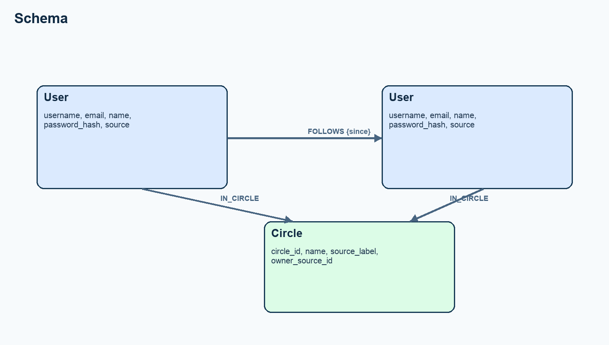
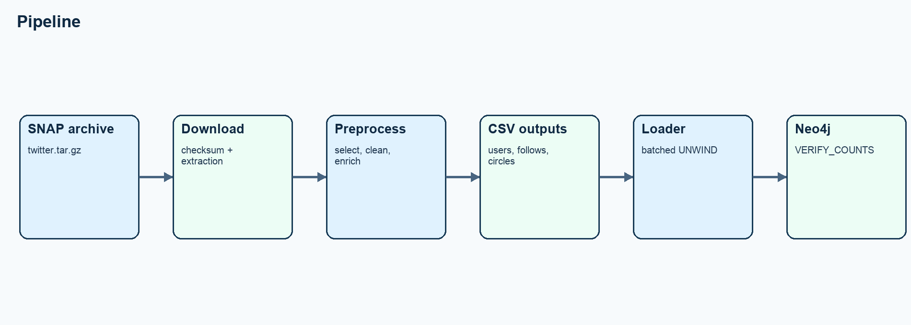
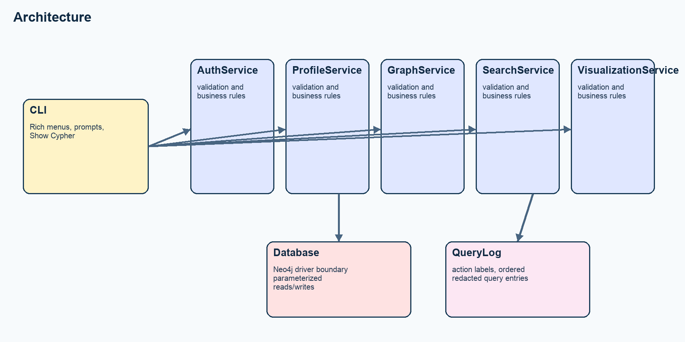
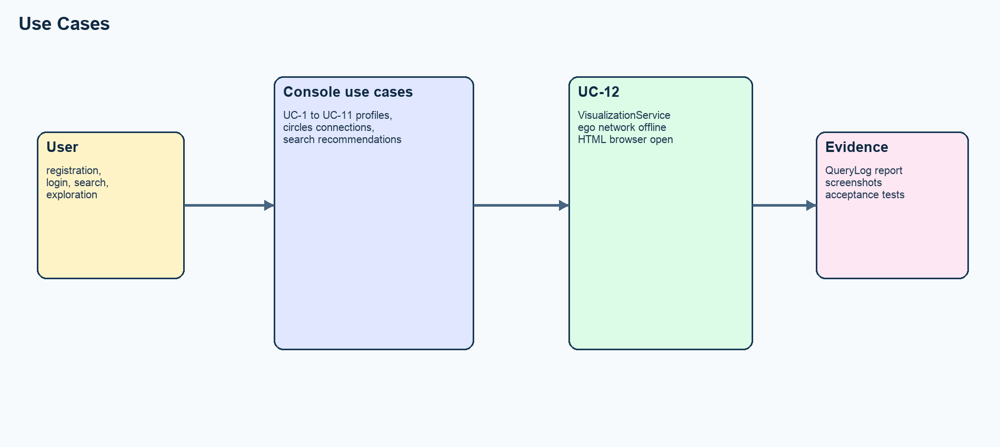

# Cypher Circle

SJSU CS157C NoSQL Database Systems

Team project report

Semester: [TO BE SUPPLIED]

Team members:

- [TEAM MEMBER NAME - TO BE SUPPLIED] - [EMAIL - TO BE SUPPLIED]
- [TEAM MEMBER NAME - TO BE SUPPLIED] - [EMAIL - TO BE SUPPLIED]
- [TEAM MEMBER NAME - TO BE SUPPLIED] - [EMAIL - TO BE SUPPLIED]

This report is generated from the checked-in implementation and the deterministic
preprocessing log. Names, emails, and screenshots are not invented when the
team has not supplied them.

<!-- PAGEBREAK -->

## 1. Project Overview

Cypher Circle is a Python 3.13 console application backed by Neo4j Community
5.26.0. It models users, directed follows, and circle membership in a property
graph. The console provides registration, authentication, profile and circle
editing, social connections, recommendations, search, popular-user discovery,
and an offline browser-based network visualization.

The project uses a deterministic subset of SNAP ego-Twitter for seeded graph
relationships. Synthetic profile fields make the graph readable without
claiming that generated names, emails, biographies, or locations are real
Twitter attributes. The application separates the Rich CLI, service-layer
validation and business logic, and the Neo4j driver boundary.

## 2. Technology Stack

| Component | Version or role |
|---|---|
| Python | 3.13.x in the project-local .venv |
| Neo4j | Community 5.26.0 |
| Driver | neo4j==5.26.0 |
| Passwords | bcrypt==5.0.0 |
| Synthetic profiles | Faker==40.54.0, locale en_US, seed 157 |
| Console | rich==15.0.0 |
| Visualization | pyvis==0.3.2, self-contained HTML |
| Configuration | python-dotenv==1.2.4 |
| Tests | pytest==9.2.0 |
| Report build | reportlab==4.4.5 and Pillow==11.3.0 |

All application Cypher is centralized in cyphercircle/queries.py and uses
parameters. db.py is the only production module importing the Neo4j driver.

## 3. Property Graph Schema



Figure 1. Property graph schema.

| Node | Important properties |
|---|---|
| User | username, email, name, name_lc, password_hash, bio, location, joined_at, updated_at, source_id, source |
| Circle | circle_id, name, source_label, owner_source_id, source |

| Relationship | Direction | Meaning |
|---|---|---|
| FOLLOWS | User -> User | Directed follow with since DateTime |
| IN_CIRCLE | User -> Circle | Dataset or app circle membership |

Unique constraints cover usernames, emails, source IDs, and circle IDs.
Text indexes cover name_lc and username. Required fields are validated by the
application because Neo4j Community does not provide existence constraints.

### `CREATE_USER_USERNAME_CONSTRAINT`

```cypher
CREATE CONSTRAINT user_username_unique IF NOT EXISTS
FOR (u:User) REQUIRE u.username IS UNIQUE
```

### `CREATE_USER_EMAIL_CONSTRAINT`

```cypher
CREATE CONSTRAINT user_email_unique IF NOT EXISTS
FOR (u:User) REQUIRE u.email IS UNIQUE
```

### `CREATE_USER_SOURCE_ID_CONSTRAINT`

```cypher
CREATE CONSTRAINT user_source_id_unique IF NOT EXISTS
FOR (u:User) REQUIRE u.source_id IS UNIQUE
```

### `CREATE_CIRCLE_ID_CONSTRAINT`

```cypher
CREATE CONSTRAINT circle_id_unique IF NOT EXISTS
FOR (c:Circle) REQUIRE c.circle_id IS UNIQUE
```

### `CREATE_USER_NAME_TEXT_INDEX`

```cypher
CREATE TEXT INDEX user_name_lc_text IF NOT EXISTS
FOR (u:User) ON (u.name_lc)
```

### `CREATE_USER_USERNAME_TEXT_INDEX`

```cypher
CREATE TEXT INDEX user_username_text IF NOT EXISTS
FOR (u:User) ON (u.username)
```

### `LOAD_CIRCLES`

```cypher
UNWIND $rows AS row
MERGE (c:Circle {circle_id: row.circle_id})
SET c.name = row.name,
    c.source_label = row.source_label,
    c.owner_source_id = row.owner_source_id,
    c.source = 'snap',
    c.load_token = $load_token
RETURN count(*) AS loaded
```

### `LOAD_USERS`

```cypher
UNWIND $rows AS row
MERGE (u:User {source_id: row.source_id})
SET u.username = row.username,
    u.email = row.email,
    u.name = row.name,
    u.name_lc = row.name_lc,
    u.password_hash = row.password_hash,
    u.bio = row.bio,
    u.location = row.location,
    u.joined_at = datetime(row.joined_at),
    u.source = 'snap',
    u.load_token = $load_token
RETURN count(*) AS loaded
```

### `LOAD_MEMBERSHIPS`

```cypher
UNWIND $rows AS row
MATCH (u:User {source_id: row.source_id})
MATCH (c:Circle {circle_id: row.circle_id, source: 'snap'})
MERGE (u)-[r:IN_CIRCLE]->(c)
SET r.load_token = $load_token
RETURN count(*) AS loaded
```

### `LOAD_FOLLOWS`

```cypher
UNWIND $rows AS row
MATCH (a:User {source_id: row.src})
MATCH (b:User {source_id: row.dst})
MERGE (a)-[r:FOLLOWS]->(b)
ON CREATE SET r.since = datetime(row.since)
SET r.load_token = $load_token
RETURN count(*) AS loaded
```

### `VERIFY_COUNTS`

```cypher
RETURN count { (:User) } AS users,
       count { (:Circle) } AS circles,
       count { ()-[:FOLLOWS]->() } AS follows,
       count { ()-[:IN_CIRCLE]->() } AS memberships
```

## 4. Dataset and Deterministic Preprocessing

### 4.1 Source and provenance

The source is SNAP ego-Twitter:

- Archive: https://snap.stanford.edu/data/twitter.tar.gz
- Dataset page: https://snap.stanford.edu/data/ego-Twitter.html
- Citation: J. McAuley and J. Leskovec, Learning to Discover Social Circles
  in Ego Networks, NIPS 2012.

The full dataset is documented as 81,306 nodes, 1,768,149 edges, and 973 ego
networks. Per-ego .edges files describe directed follows among followees;
.circles files describe user-created lists. The project does not use
twitter_combined.txt.gz.

This dataset was chosen because its directed follow edges make Following and
Followers distinct for UC-7, and its circle lists provide a second node type
with real provenance. An ego-Facebook graph is undirected, so converting it to
follows would make those two lists identical; email-Eu-core records email
communication rather than a follow relationship. The selected subset keeps
loading and screenshots practical while exceeding the project thresholds.

The archive SHA-256 recorded by this run is `5ed7b52a8013a1a1d43301a5414dfcb844e50cb4e2fb8dc801a7bef399552bb0`. Public
availability through SNAP is not an unrestricted open-source license claim.

### 4.2 Subset selection and cleaning

Ego IDs are processed in numeric order until both production thresholds are
met. The selected egos are 23 of 973 total ego
networks. The final deterministic subset has:

| Field | Value |
|---|---|
| `users` | 3,187 |
| `follows` | 60,991 |
| `circles` | 86 |
| `memberships` | 1,299 |

The preprocessing log records 60,204 edges from ego files and
3,420 reconstructed ego-to-user edges. SNAP documents that the
ego follows every node in its file; these edges are reconstructed from that
meaning and are not additional lines in the .edges files.

Cleaning removed 8 self-loops, 2,625
duplicate edges, and 0 dangling edges. It parsed
107 raw circles, dropped 21 circles smaller than
three members, and retained 2,281 users without a circle.
Circle membership comes from the original Twitter lists, filtered to users
included in our deterministic subset. Circle names are synthetic; the original
circle label is retained only as source_label for provenance.

### 4.3 Synthetic enrichment and reproducibility

Every displayed profile field is synthetic. Faker is pinned at `40.54.0`,
uses locale en_US, and is seeded with `157`. Usernames are generated in
sorted source-ID order and are unique and normalized. Emails use example.com.
Bio, location, names, joined timestamps, follow timestamps, and circle names
are generated deterministically.

CSV rows and JSON keys are sorted and the preprocessing log contains no run
timestamp. Running make data twice on the same archive must produce
byte-identical processed files.

| Processed file | SHA-256 |
|---|---|
| Field | Value |
|---|---|
| `circles.csv` | `8c1ede3fc00a368e63d2227a4c48223d8af85584be1d9914e4c8a782740e3136` |
| `follows.csv` | `fb765549cd7dd806655f5d7ed2210d670d9d8af75cc1419afb820adb2c97d427` |
| `memberships.csv` | `c3c2a8a6f2cafcafc41a265362a65d9fac02fcef0608c105e7b6a91f3e62a689` |
| `users.csv` | `5a61e57f47d1e4dd0fb4b5472af915d46e5a49517e3205c466963a8dd9a9db03` |

### 4.4 Demo values

These values are read from data/processed/preprocess_log.json, not hardcoded:

| Field | Value |
|---|---|
| `busy_user` | `mark.w_0208` |
| `busy_user_rule` | `0.20` |
| `busy_user_network_recommendations` | 253 |
| `mutual_partner` | `taylor.r_0093` |
| `no_circle_user` | `cheryl.w_0000` |
| `demo_search_term` | `zoe` |
| `demo_search_matches` | 1 |

The seeded password is a public demo-only credential and is not production
security.

### 4.5 Loading and database verification



Figure 2. Download, preprocess, load, and verify pipeline.

The loader validates archive binding, processed-file hashes, CSV headers, row
counts, required fields, endpoints, circle ownership, and minimums before a
reset can delete database data. It loads parameterized UNWIND batches of 1,000,
creates constraints and indexes, and compares live VERIFY_COUNTS with the log.

Processed dataset counts are the values above. The live database result at
report-build time is:

Live Neo4j VERIFY_COUNTS was unavailable; run make up and make load, then rebuild the report.

If Neo4j is unavailable, no live count is invented. Run make up, make data,
make load, and rebuild the report before submission.

## 5. Architecture



Figure 3. Console, services, data boundary, and QueryLog.

The CLI communicates only with AuthService, ProfileService, GraphService,
SearchService, and VisualizationService. Services validate inputs, enforce
actor scoping through authenticated Session, call named queries, and return
application dataclasses. Database translates Neo4j failures into application
errors. QueryLog records ordered, recursively redacted queries for Show Cypher.



Figure 4. Use-case and evidence relationships.

The visualizer reads a capped ego network, writes
output/network_username.html, removes external resources, and opens the
offline page in a browser.

## 6. Use Cases

| Use case | Behavior | Verification |
|---|---|---|
| UC-1 | Register with validation, hidden password confirmation, optional bio, and up to three circles | Unit tests and strict integration when Neo4j is available |
| UC-2 | Login with generic authentication errors and three attempts | CLI unit and integration tests |
| UC-3 | View profile with counts and up to five circles | Profile service and CLI tests |
| UC-4 | Edit details, join circles, leave circles, and clear optional fields with a dash | Profile service and CLI tests |
| UC-5 | Follow a target with self, missing, and duplicate checks | Graph service and integration tests |
| UC-6 | Unfollow a target with missing relationship handling | Graph service and integration tests |
| UC-7 | Paginated Following and Followers tables with follow-back indicators | CLI pagination and integration tests |
| UC-8 | True mutual total, paginated users, and relationship status | Graph service and integration tests |
| UC-9 | Network, circle, and popular recommendation tiers with reasons and scores | Recommendation tests and QueryLog assertions |
| UC-10 | Normalized case-insensitive search excluding the current user | Search service and CLI tests |
| UC-11 | Ranked popular users and follow selection | Search service and CLI tests |
| UC-12 | Capped directed ego graph rendered as offline HTML | Visualization service, CLI, and strict integration tests |

### 6.1 Query appendix

### UC-1 - User registration

### `GET_TOP_CIRCLES`

```cypher
MATCH (c:Circle)
RETURN c.circle_id AS circle_id, c.name AS name,
       count { (:User)-[:IN_CIRCLE]->(c) } AS members
ORDER BY members DESC, name ASC, circle_id ASC
LIMIT $limit
```

### `CIRCLE_EXISTS`

```cypher
MATCH (c:Circle {circle_id: $circle_id})
RETURN count(c) > 0 AS exists
```

### `CHECK_REGISTRATION_CONFLICTS`

```cypher
OPTIONAL MATCH (a:User {username: $username})
OPTIONAL MATCH (b:User {email: $email})
RETURN a IS NOT NULL AS username_taken,
       b IS NOT NULL AS email_taken
```

### `CREATE_USER_WITH_CIRCLES`

```cypher
CREATE (u:User {
  username: $username,
  email: $email,
  name: $name,
  name_lc: toLower($name),
  password_hash: $password_hash,
  bio: $bio,
  location: $location,
  joined_at: datetime(),
  source: 'app'
})
WITH u, $circle_ids AS circle_ids
CALL (u, circle_ids) {
  MATCH (c:Circle)
  WHERE c.circle_id IN circle_ids
  WITH c ORDER BY c.circle_id ASC
  RETURN collect(c) AS circles
}
FOREACH (circle IN circles | MERGE (u)-[:IN_CIRCLE]->(circle))
RETURN u.username AS username, u.name AS name
```

### UC-2 - User login

### `GET_AUTH_BY_USERNAME`

```cypher
MATCH (u:User {username: $username})
RETURN u.password_hash AS password_hash, u.name AS name
```

### UC-3 - View profile

### `GET_PROFILE`

```cypher
MATCH (u:User {username: $username})
CALL (u) {
  MATCH (u)-[:IN_CIRCLE]->(c:Circle)
  WITH c ORDER BY c.name ASC, c.circle_id ASC
  RETURN collect(c.name) AS circle_names
}
RETURN u.username AS username, u.name AS name, u.email AS email,
       u.bio AS bio, u.location AS location, u.joined_at AS joined_at,
       circle_names[..5] AS circles, size(circle_names) AS circle_count,
       count { (u)-[:FOLLOWS]->(:User) } AS following_count,
       count { (:User)-[:FOLLOWS]->(u) } AS followers_count
```

### UC-4 - Edit profile

### `GET_MY_CIRCLES`

```cypher
MATCH (u:User {username: $username})-[:IN_CIRCLE]->(c:Circle)
RETURN c.circle_id AS circle_id, c.name AS name
ORDER BY name ASC, circle_id ASC
```

### `USER_EXISTS`

```cypher
MATCH (u:User {username: $username})
RETURN count(u) > 0 AS exists
```

### `CIRCLE_EXISTS`

```cypher
MATCH (c:Circle {circle_id: $circle_id})
RETURN count(c) > 0 AS exists
```

### `UPDATE_PROFILE`

```cypher
MATCH (u:User {username: $username})
SET u.name = coalesce($name, u.name),
    u.name_lc = toLower(coalesce($name, u.name)),
    u.bio = coalesce($bio, u.bio),
    u.location = coalesce($location, u.location),
    u.updated_at = datetime()
RETURN u.username AS username
```

### `CLEAR_BIO`

```cypher
MATCH (u:User {username: $username})
SET u.bio = null, u.updated_at = datetime()
RETURN u.username AS username
```

### `CLEAR_LOCATION`

```cypher
MATCH (u:User {username: $username})
SET u.location = null, u.updated_at = datetime()
RETURN u.username AS username
```

### `JOIN_CIRCLE`

```cypher
MATCH (u:User {username: $username}), (c:Circle {circle_id: $circle_id})
MERGE (u)-[:IN_CIRCLE]->(c)
```

### `LEAVE_CIRCLE`

```cypher
MATCH (u:User {username: $username})-[r:IN_CIRCLE]->(c:Circle {circle_id: $circle_id})
DELETE r
```

### `GET_PROFILE`

```cypher
MATCH (u:User {username: $username})
CALL (u) {
  MATCH (u)-[:IN_CIRCLE]->(c:Circle)
  WITH c ORDER BY c.name ASC, c.circle_id ASC
  RETURN collect(c.name) AS circle_names
}
RETURN u.username AS username, u.name AS name, u.email AS email,
       u.bio AS bio, u.location AS location, u.joined_at AS joined_at,
       circle_names[..5] AS circles, size(circle_names) AS circle_count,
       count { (u)-[:FOLLOWS]->(:User) } AS following_count,
       count { (:User)-[:FOLLOWS]->(u) } AS followers_count
```

### UC-5 - Follow a user

### `USER_EXISTS`

```cypher
MATCH (u:User {username: $username})
RETURN count(u) > 0 AS exists
```

### `FOLLOW_USER`

```cypher
MATCH (me:User {username: $me}), (target:User {username: $target})
WHERE me <> target
MERGE (me)-[r:FOLLOWS]->(target)
ON CREATE SET r.since = datetime()
RETURN r.since AS since
```

### UC-6 - Unfollow a user

### `USER_EXISTS`

```cypher
MATCH (u:User {username: $username})
RETURN count(u) > 0 AS exists
```

### `UNFOLLOW_USER`

```cypher
MATCH (me:User {username: $me})-[r:FOLLOWS]->(target:User {username: $target})
DELETE r
```

### UC-7 - View connections

### `USER_EXISTS`

```cypher
MATCH (u:User {username: $username})
RETURN count(u) > 0 AS exists
```

### `COUNT_CONNECTIONS`

```cypher
MATCH (me:User {username: $username})
RETURN count { (me)-[:FOLLOWS]->(:User) } AS following,
       count { (:User)-[:FOLLOWS]->(me) } AS followers
```

### `GET_FOLLOWING`

```cypher
MATCH (me:User {username: $username})-[r:FOLLOWS]->(u:User)
RETURN u.username AS username, u.name AS name, u.location AS location,
       r.since AS since,
       EXISTS { (u)-[:FOLLOWS]->(me) } AS follows_back
ORDER BY since DESC, username ASC
SKIP $skip LIMIT $limit
```

### `GET_FOLLOWERS`

```cypher
MATCH (u:User)-[r:FOLLOWS]->(me:User {username: $username})
RETURN u.username AS username, u.name AS name, u.location AS location,
       r.since AS since,
       EXISTS { (me)-[:FOLLOWS]->(u) } AS i_follow_back
ORDER BY since DESC, username ASC
SKIP $skip LIMIT $limit
```

### UC-8 - Mutual connections

### `USER_EXISTS`

```cypher
MATCH (u:User {username: $username})
RETURN count(u) > 0 AS exists
```

### `COUNT_MUTUAL_FOLLOWING`

```cypher
MATCH (me:User {username: $me})-[:FOLLOWS]->(m:User)<-[:FOLLOWS]-(other:User {username: $other})
RETURN count(DISTINCT m) AS total
```

### `GET_MUTUAL_FOLLOWING`

```cypher
MATCH (me:User {username: $me})-[:FOLLOWS]->(m:User)<-[:FOLLOWS]-(other:User {username: $other})
RETURN m.username AS username, m.name AS name, m.location AS location
ORDER BY m.name ASC, m.username ASC
SKIP $skip LIMIT $limit
```

### `GET_RELATIONSHIP_STATUS`

```cypher
MATCH (me:User {username: $me}), (other:User {username: $other})
RETURN EXISTS { (me)-[:FOLLOWS]->(other) } AS i_follow,
       EXISTS { (other)-[:FOLLOWS]->(me) } AS they_follow
```

### UC-9 - Friend recommendations

### `USER_EXISTS`

```cypher
MATCH (u:User {username: $username})
RETURN count(u) > 0 AS exists
```

### `GET_FOLLOWING_USERNAMES`

```cypher
MATCH (:User {username: $username})-[:FOLLOWS]->(u:User)
WITH u ORDER BY u.username ASC
RETURN collect(u.username) AS usernames
```

### `RECOMMEND_BY_NETWORK`

```cypher
MATCH (me:User {username: $username})-[:FOLLOWS]->(mid:User)-[:FOLLOWS]->(rec:User)
WHERE rec <> me AND NOT (me)-[:FOLLOWS]->(rec)
WITH rec, mid ORDER BY mid.username ASC
WITH rec, count(DISTINCT mid) AS score, collect(DISTINCT mid.username)[..3] AS via
RETURN rec.username AS username,
       rec.name AS name,
       rec.location AS location,
       count { (:User)-[:FOLLOWS]->(rec) } AS followers,
       score,
       via
ORDER BY score DESC, followers DESC, username ASC
LIMIT $limit
```

### `GET_MY_CIRCLES`

```cypher
MATCH (u:User {username: $username})-[:IN_CIRCLE]->(c:Circle)
RETURN c.circle_id AS circle_id, c.name AS name
ORDER BY name ASC, circle_id ASC
```

### `RECOMMEND_BY_CIRCLE`

```cypher
MATCH (me:User {username: $username})-[:IN_CIRCLE]->(c:Circle)<-[:IN_CIRCLE]-(rec:User)
WHERE rec <> me AND NOT (me)-[:FOLLOWS]->(rec) AND NOT rec.username IN $exclude
WITH rec, min(c.name) AS circle
WITH rec, circle, count { (:User)-[:FOLLOWS]->(rec) } AS followers
RETURN rec.username AS username, rec.name AS name, rec.location AS location,
       followers, circle
ORDER BY followers DESC, username ASC
LIMIT $limit
```

### `GET_POPULAR_USERS`

```cypher
MATCH (u:User)
WHERE NOT u.username IN $exclude
WITH u, count { (:User)-[:FOLLOWS]->(u) } AS followers
RETURN u.username AS username, u.name AS name, u.location AS location, followers
ORDER BY followers DESC, username ASC
LIMIT $limit
```

### UC-10 - Search users

### `SEARCH_USERS`

```cypher
MATCH (u:User)
WHERE u.username <> $me
  AND (u.name_lc CONTAINS $q OR u.username CONTAINS $q)
WITH u,
     count { (:User)-[:FOLLOWS]->(u) } AS followers,
     CASE WHEN u.username STARTS WITH $q OR u.name_lc STARTS WITH $q THEN 0 ELSE 1 END AS rank
RETURN u.username AS username, u.name AS name, u.location AS location, followers,
       EXISTS { (:User {username: $me})-[:FOLLOWS]->(u) } AS i_follow
ORDER BY rank, followers DESC, username ASC
LIMIT $limit
```

### UC-11 - Explore popular users

### `GET_POPULAR_USERS`

```cypher
MATCH (u:User)
WHERE NOT u.username IN $exclude
WITH u, count { (:User)-[:FOLLOWS]->(u) } AS followers
RETURN u.username AS username, u.name AS name, u.location AS location, followers
ORDER BY followers DESC, username ASC
LIMIT $limit
```

### UC-12 - Network visualization

### `GET_EGO_NETWORK`

```cypher
MATCH (me:User {username: $username})
CALL (me) {
  MATCH (me)-[:FOLLOWS]->(o:User)
  WITH o ORDER BY o.username ASC
  RETURN collect(o)[..$cap] AS outs
}
CALL (me) {
  MATCH (i:User)-[:FOLLOWS]->(me)
  WITH i ORDER BY i.username ASC
  RETURN collect(i)[..$cap] AS ins
}
RETURN me.username AS center, me.name AS center_name,
       [x IN outs | {username: x.username, name: x.name}] AS following,
       [x IN ins  | {username: x.username, name: x.name}] AS followers
```

### `GET_EDGES_AMONG`

```cypher
MATCH (a:User)-[:FOLLOWS]->(b:User)
WHERE a.username IN $usernames AND b.username IN $usernames
RETURN a.username AS src, b.username AS dst
ORDER BY src ASC, dst ASC
LIMIT $edge_cap
```

### 6.2 Evidence checklist

No report screenshots were found in report/screenshots/ at build time. These
placeholders are not claims that screenshots exist.

| File | Required evidence |
|---|---|
| uc01.png | UC-1 registration prompts and account-created message |
| uc02.png | UC-2 login and welcome message |
| uc03.png | UC-3 profile card and circles |
| uc04.png | UC-4 edited profile and circle membership |
| uc05.png | UC-5 follow success |
| uc06.png | UC-6 unfollow success |
| uc07.png | UC-7 separate Following and Followers tables |
| uc08.png | UC-8 mutual total and relationship status |
| uc09.png | UC-9 reasons, scores, and Show Cypher |
| uc10.png | UC-10 normalized search and following status |
| uc11.png | UC-11 popular-user leaderboard |
| uc12.png | UC-12 console confirmation and browser graph |

Run make demo-info for current usernames and the search term. Run make run,
enable Show Cypher with C, and capture the labeled screens from DESIGN.md
Section 15. UC-12 also requires a browser capture. Verify that no password,
password hash, local credential, or unrelated user data appears.

## 7. Security and Correctness

- Passwords are validated and hashed with bcrypt. Seeded credentials are demo-only.
- All Cypher is named and parameterized in cyphercircle/queries.py.
- Actor-scoped operations derive the acting username from Session.
- QueryLog recursively redacts keys containing password and truncates large lists.
- Neo4j failures become application errors; the CLI logs unexpected failures
  without showing a traceback.
- Rich output and visualization labels remove terminal controls and escape HTML.
- Visualization HTML rejects external src and href resources.
- The generated network is directed and capped at 50 following users, 50
  followers, and 500 edges.
- SNAP relationships and synthetic profile fields are documented separately.

## 8. Reproducibility and Setup

Use Python 3.13 in the project-local environment:

```sh
python3.13 -m venv .venv
source .venv/bin/activate
pip install -r requirements.txt
cp .env.example .env
make verify-env
make up
make data
make load
make test
make test-integration
make run
```

make report requires the local environment, ReportLab, Pillow, and Poppler
(pdfinfo, pdftotext, and pdftoppm). It generates diagrams, renders the
Markdown report to report/report.pdf, extracts text, and renders every page.
No network asset is used by the report builder.

## 9. Testing and Acceptance

The report builder ran the clean-clone-compatible unit suite:

97 passed, 6 deselected

make verify-env, compile checks, and git diff --check are required acceptance
checks. Strict integration tests require local Neo4j and must fail clearly when
Neo4j is unavailable. The live status at build time is stated in Section 4.5.

## 10. Team Responsibilities

Team assignments are placeholders because no names or emails were supplied.
Fill the title page and this table before submission.

| Area | Owner |
|---|---|
| Data pipeline, schema, loader | [TO BE SUPPLIED] |
| AuthService and ProfileService | [TO BE SUPPLIED] |
| GraphService | [TO BE SUPPLIED] |
| SearchService, VisualizationService, CLI, report | [TO BE SUPPLIED] |

## 11. Limitations and Future Work

- The graph is a deterministic union of selected ego networks, not a complete
  Twitter graph. Missing edges are not confirmed non-connections.
- SNAP provenance and license claims remain conservative.
- The console and generated static visualization are not a web API or GUI.
- The seeded password is suitable only for the public demo path.
- Screenshots, team identities, semester, and live Neo4j counts remain
  submission evidence to supply when unavailable during this build.
